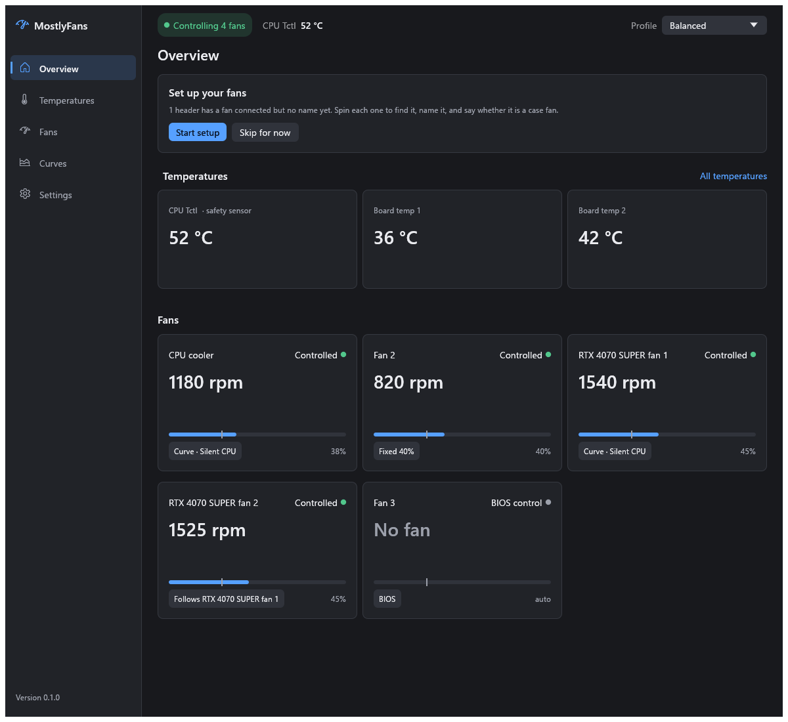
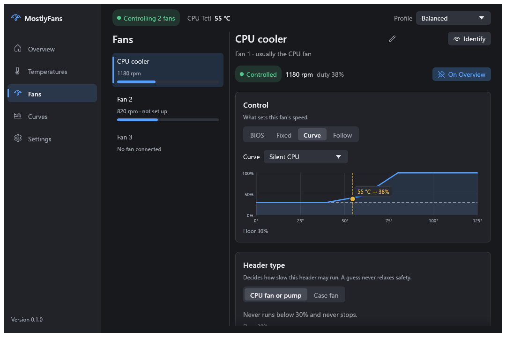
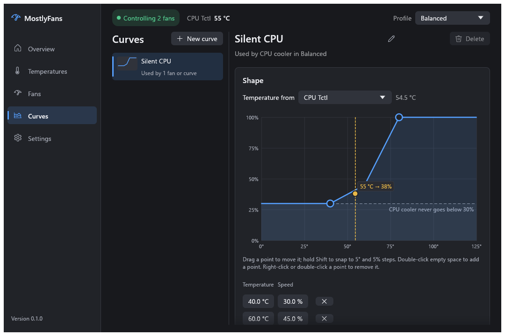
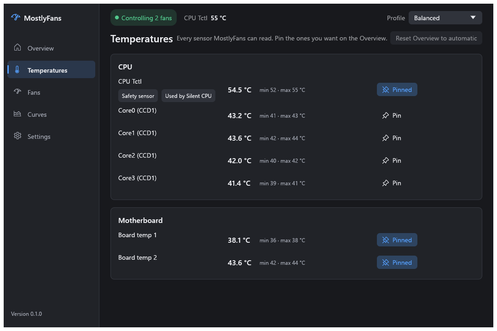
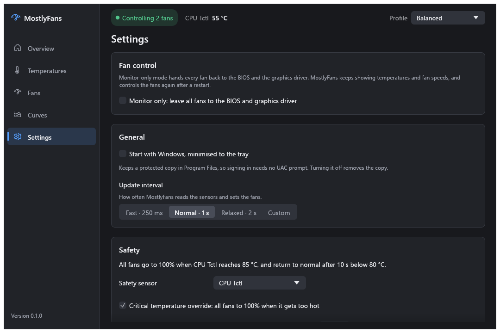

# MostlyFans

**Quiet when you're browsing, cool when you're gaming.** MostlyFans is a free fan control app for Windows. Set how fast your case, CPU and NVIDIA graphics card fans spin based on how hot things get, all from one small app that sits in the system tray.

[**Download the latest release**](https://github.com/josephmurrells/mostlyfans/releases/latest) · Windows 10/11, 64-bit · portable, no installer · free and open source



## Why MostlyFans

- **One curve per fan.** Make each fan follow the CPU, the GPU, a drive or a motherboard sensor, or just run at a fixed speed. Drag points on a graph to shape the curve.
- **Profiles you can flip.** Silent, Balanced and Performance come ready to go, each with its own fan settings. Switch from the window or right from the tray.
- **Every temperature in one place.** CPU (including each core on supported CPUs), motherboard, GPU and drives, with the lowest and highest since start. Pin the ones you care about to the Overview.
- **Hard to get wrong.** Fans never drop below a safe minimum, go to full speed if the CPU gets too hot or a sensor fails, and go back to your BIOS settings when MostlyFans stops, even if it crashes.
- **Works on its own.** No other monitoring tools needed, no account, no telemetry: the only thing it ever downloads is the PawnIO driver installer, when you ask it to. It used to be called FanForge.

> [!WARNING]
> **Use MostlyFans at your own risk.** It writes directly to your motherboard's fan controller and your graphics card's fan settings through a kernel driver. Most of the supported chips are driven from public documentation and other open-source tools, not tested on every board, and a wrong setting, a bug or an unusual BIOS could leave a fan too slow, stop it, or make your PC run hot. Keep an eye on your temperatures after you set it up, and stop using it if anything looks wrong. MostlyFans comes with no warranty: the authors aren't liable for damage to your hardware, lost data or anything else that results from using it (see sections 15 and 16 of the [license](LICENSE)).

## Will it work on my PC?

Most likely, if you have one of these:

- **A desktop motherboard from ASUS, Gigabyte, MSI or ASRock.** Most of these use an ITE or Nuvoton fan controller chip that MostlyFans supports. The full list is under [Supported hardware](#supported-hardware).
- **An NVIDIA GeForce graphics card**, GTX 900 series or newer. Most desktop cards work; laptops usually don't allow fan control.

You also need Windows 11 (Windows 10 should work but hasn't been tested) and administrator rights. Not sure what's in your PC? Just run MostlyFans: **Settings → About** shows your fan controller chip, and if it can't control your fans, the notice at the top of the window says why.
## Getting started

1. **Download** `MostlyFans-<version>-windows-x64.zip` from [Releases](https://github.com/josephmurrells/mostlyfans/releases/latest) and extract it anywhere. Keep the files together: the folder also holds `mostlyfans-diag.exe` (for bug reports) and the licence files.
2. **Run** `mostlyfans.exe` and accept the administrator prompt. Windows may warn about an "unknown publisher" because MostlyFans isn't code-signed yet; see [checking your download](#checking-your-download).
3. **Install PawnIO** if asked. Motherboard fans are reached through [PawnIO](https://pawnio.eu), a signed driver also used by FanControl and LibreHardwareMonitor. Click **Install PawnIO** and MostlyFans downloads the official installer, checks it hasn't been tampered with and installs it. Graphics card fans work without it.
4. **Find your fans.** On the Overview, click **Start setup** under **Set up your fans**. For each fan socket, **Identify** spins that fan at full speed for 3 seconds so you can see which one it is. Give it a name and say whether it's a **Case fan** or a **CPU fan or pump**.
5. **Make a curve.** On the **Curves** page, click **New curve** and pick a type: your own points, a straight line, a fixed speed, or a mix of other curves.
6. **Use it.** On the **Fans** page, set a fan's **Control** to **Curve** and pick your curve. Fans you don't change stay on your BIOS settings.
7. **Click Apply** (or press Ctrl+S). Nothing changes until you apply; **Revert** throws your edits away.

Optionally, click **Calibrate** on a fan to measure the speed where it stops and starts, so its minimum is based on the real fan.

Closing the window keeps MostlyFans running in the tray; double-click the tray icon to bring it back. To stop it, choose **Quit MostlyFans** from the tray menu and your fans go straight back to the BIOS. To start it with Windows, turn on **Start with Windows** in Settings: it then starts hidden in the tray when you sign in, with no administrator prompt.

## A tour of the app

### Fans

Each fan's speed and settings in one place. **Control** decides what sets its speed: **BIOS**, a **Fixed** speed, a **Curve**, or **Follow** another fan. Here you also set the name, header type, **Minimum duty** (the lowest power it gets, in %), **Allow 0 RPM**, and pin the fan to the Overview. Graphics card fans have their own group, with **Driver** instead of BIOS.



### Curves

Drag points to shape a curve, hold Shift to snap to neat steps, and see live where the current temperature sits on it. Pick which sensor it follows and how quickly fans react to changes (**Fast**, **Smooth** or **Gentle**), so a short CPU spike doesn't make them rev up and down.



### Temperatures

Every sensor MostlyFans can read, grouped by CPU, motherboard, GPU, drives and other, with the lowest and highest since start. Pin any of them to the Overview. Sensors with nothing connected are folded away under "Not reporting".



### Settings

**Monitor only** (pause fan control without quitting), profiles, the safety sensor and critical temperature, Start with Windows, how often fans update, and **About**, which shows your fan controller chip and has **Open log folder**.



## How MostlyFans keeps your PC safe

MostlyFans is built so a mistake, a crash or a bad setting can't leave your PC without cooling.

- **Fans don't stop by accident.** Every fan keeps at least 30%, or 20% once you mark it as a case fan. A fan only stops completely if it's a case fan and you turn on **Allow 0 RPM**. A pump may need more than 30%, so give it a higher **Minimum duty**. Graphics card fans keep at least the driver's minimum (and never less than 30%) and never stop while MostlyFans drives them; set their **Control** to **Driver** to get the card's own quiet mode with 0 RPM at idle back.
- **Too hot means full speed.** If the CPU reaches 85 °C (you can change this), every fan, including graphics card fans left on **Driver**, goes to full speed until it cools below the "Back to normal below" temperature.
- **A broken sensor means full speed.** If a sensor a curve uses stops reporting, that fan goes to full speed. If the safety sensor stops, every fan does.
- **Stuck fans go back to the BIOS.** If a motherboard fan stops while MostlyFans asks it to spin, MostlyFans runs it at full speed for 2 seconds, then hands it back to the BIOS and shows why. It does the same, without the full-speed burst, when a fan's speed doesn't change with its power (for example a 3-pin fan on a PWM socket, or a pump). Fix the cause, then press **Try again**. For a pump or a fixed-speed fan, turn off **Response check** in that fan's **Advanced** settings.
- **When MostlyFans stops, your BIOS takes over.** Quitting, signing out, shutting down, sleeping, a crash, or **End task** in Task Manager all hand every fan back to your BIOS settings (and graphics card fans to the driver). A small watchdog process does this even if the main app is killed. The one exception is Task Manager's **End process tree**, which stops the watchdog too: fans then stay at their last speed, never below their minimum, until MostlyFans next starts (or, for graphics card fans, until the PC restarts).
- **No fighting with other fan apps.** If FanControl, SpeedFan, Argus Monitor, Fan Xpert, AI Suite 3 or Armoury Crate is running, MostlyFans only monitors and never touches the fans. If MSI Afterburner, EVGA Precision X1 or ASUS GPU Tweak III is running, only the graphics card fans are left alone. A graphics card fan that another program has already set to a manual speed is never taken over.

To pause fan control without quitting, turn on **Monitor only** in Settings or the tray menu. Every fan goes back to the BIOS (and graphics card fans to the driver) while MostlyFans keeps showing temperatures and speeds, and the safety overrides don't act, just as if MostlyFans were closed. **Resume control** in the notice turns it off again, and so does restarting MostlyFans.

You can turn off the critical-temperature and failed-sensor overrides in Settings. A warning stays on screen while either is off, and reaching the critical temperature still shows a red alert. The minimum speeds and the return to BIOS control are always on.

## Questions and troubleshooting

**I see no fans, or it says "monitoring only".** The notice at the top of the window says why. Usually PawnIO isn't installed, another fan app is running, or your chip isn't supported for fan control yet.

**A fan doesn't respond.** In the BIOS, set that fan socket to an automatic fan curve (not "Full speed" or "Manual"), using PWM mode for 4-pin fans and DC/Voltage mode for 3-pin fans. Then check the message for that fan on the Fans page.

**Can I run it with HWiNFO, Afterburner and so on?**

- **Monitoring tools** like HWiNFO and HWMonitor are fine. LibreHardwareMonitor and OpenHardwareMonitor are too, but MostlyFans shows a warning while they run, because their fan control would fight MostlyFans's; leave it off.
- **Other fan controllers** put MostlyFans into monitoring-only mode while they run.
- **MSI Afterburner** and similar GPU tools are fine for overlays and overclocking. While one runs, MostlyFans leaves the graphics card fans to it and keeps controlling the rest. If you want MostlyFans to drive the graphics card fans, close the tool, or turn its fan control off and restart it so the fans go back to the driver.

**Will it upset anti-cheat?** Some anti-cheat systems are wary of hardware-access drivers like PawnIO, which stays installed after you quit MostlyFans. If a game objects, uninstall PawnIO from **Settings > Apps** in Windows. Other tools that use it (such as FanControl and LibreHardwareMonitor) will stop working too.

<a id="checking-your-download"></a>
**Windows says "unknown publisher". Is the download safe?** MostlyFans isn't code-signed yet, so SmartScreen and the administrator prompt show that warning. To check a download is genuine, compare it with the release's `SHA256SUMS.txt`, or, with the [GitHub CLI](https://cli.github.com), run `gh attestation verify <the zip> -R josephmurrells/mostlyfans`, which confirms it was built by this repository's release workflow.

**Where are my settings and logs?** Settings are in `C:\ProgramData\MostlyFans` and logs in `C:\ProgramData\MostlyFans\logs` (or **Settings → Open log folder**).

**Something went wrong. How do I report it?** Open an [issue](https://github.com/josephmurrells/mostlyfans/issues/new/choose) with your fan controller chip (Settings → About), the latest log file and, if it's about the motherboard fans, the output of `mostlyfans-diag detect` run from an administrator terminal. Security problems go through [SECURITY.md](SECURITY.md) instead.

## Updating

Quit MostlyFans from the tray, replace the extracted folder (or at least `mostlyfans.exe` and `mostlyfans-diag.exe`) with the new release, and run `mostlyfans.exe` once. If **Start with Windows** is on, its copy updates itself.

<details>
<summary><b>Coming from FanForge</b></summary>

MostlyFans keeps its settings in a new folder and doesn't take over FanForge's. The two never run at the same time: whichever starts second refuses to start. (FanForge words this as "FanForge is already controlling fans in another user session"; it means MostlyFans.)

1. In FanForge, turn off **Start with Windows** in Settings, then quit it from the tray.
2. Start MostlyFans once, then quit it from the tray. This creates `C:\ProgramData\MostlyFans` with the right permissions; don't create the folder yourself, or MostlyFans refuses to start.
3. To keep your fan names, curves and profiles, copy everything in `C:\ProgramData\FanForge` except the `logs` folder into `C:\ProgramData\MostlyFans`, replacing the files there. Explorer asks for administrator permission. The Overview pins go back to automatic.
4. Delete `fanforge.exe`, and optionally `C:\ProgramData\FanForge` and `C:\Program Files\FanForge`.

</details>

## Uninstalling

1. Turn off **Start with Windows** in Settings.
2. Quit MostlyFans from the tray.
3. Delete `mostlyfans.exe`.
4. Optionally delete `C:\ProgramData\MostlyFans` (your settings), and uninstall PawnIO from **Settings > Apps** if no other tool needs it.

## Supported hardware

**Motherboard fan control**

| Chip | Fan control |
|---|---|
| ITE IT8620E, IT8625E, IT8628E, IT8655E, IT8665E, IT8686E, IT8688E, IT8689E, IT8696E, IT8721F, IT8728F, IT8772E | Yes |
| Nuvoton NCT6771F / NCT6775F, NCT6776F, NCT6779D, NCT6791D, NCT6792D, NCT6792D-A, NCT6793D, NCT6795D, NCT6796D, NCT6796D-R / NCT5585D, NCT6797D, NCT6798D, NCT6799D / NCT6796D-S | Yes |
| Nuvoton NCT6686D (MSI) | Yes |
| Nuvoton NCT6687D (MSI) | Yes. On MSI 800-series boards (B840, B850, B860, X870, Z890), only the CPU and Pump headers |
| Nuvoton NCT6683D | Monitoring only |

To see which chip you have, open **Settings → About → Fan controller**. Fan sockets the board doesn't wire as fan headers are hidden, and one whose control pin the board uses for something else shows its speed but can't be controlled. On a chip that isn't in this table, MostlyFans finds no fan headers and says so. Some larger Gigabyte boards have a second fan chip (IT8790E, IT8792E or IT87952E). Its fans and temperatures show up in their own group. On Gigabyte boards where MostlyFans can reach the board's own fan controller, MostlyFans controls the IT8792E and IT87952E fans too (not yet tested on real hardware); otherwise they're monitor only, and the Fans page says why.

**Graphics card fans**

- **NVIDIA:** GeForce cards from the GTX 900 series on with driver fan control (most desktop cards; laptops usually don't allow it), through the driver's NVML. Tested on an RTX 4070 SUPER.
- **AMD Radeon:** not yet; planned.

**Temperatures**

- **CPU:** AMD Ryzen and Intel Core. Per-core temperatures on Intel, on Ryzen 3000 and 5000 desktop CPUs (6 to 16 cores), and on Ryzen 5000G APUs. Per-core readings are for display; curves use the overall CPU temperature.
- **GPU:** NVIDIA through the driver's NVML, and AMD Radeon through Adrenalin (edge, hotspot and memory). Radeon support hasn't been tested on real hardware yet.
- **Drives:** NVMe and SATA SSDs. Spinning hard disks aren't polled, so they can still spin down.

Got a board that works (or doesn't)? A [hardware report](https://github.com/josephmurrells/mostlyfans/issues/new/choose) helps other people with the same board.

## For developers

You need Rust 1.95+ and the MSVC toolchain (Visual Studio Build Tools with the C++ workload).

```powershell
cargo build --release
```

The app is `target\release\mostlyfans.exe`, and the diagnostics tool is `target\release\mostlyfans-diag.exe`. How MostlyFans drives each chip, the safety internals and the diagnostics tool are described in [docs/technical.md](docs/technical.md). Bug reports, hardware reports and pull requests are welcome; see [CONTRIBUTING.md](CONTRIBUTING.md) for how to build, test and submit changes.

## License

Copyright (C) 2026 Joseph Murrells.

MostlyFans is free software, licensed under the [GNU General Public License v3.0 or later](LICENSE). `crates/hw/src/chips.rs`, `ite.rs` and `nuvoton.rs` are derived from LibreHardwareMonitor and are also covered by the [Mozilla Public License 2.0](LICENSE-MPL-2.0). It embeds signed [PawnIO modules](https://github.com/namazso/PawnIO.Modules) (LGPL-2.1, [license text](crates/hw/modules/LICENSE-LGPL-2.1), source at the [0.2.11 tag](https://github.com/namazso/PawnIO.Modules/tree/0.2.11)). Third-party components keep their own licenses, listed in [NOTICE](NOTICE).

MostlyFans is distributed in the hope that it will be useful, but WITHOUT ANY WARRANTY; without even the implied warranty of MERCHANTABILITY or FITNESS FOR A PARTICULAR PURPOSE. See the GNU General Public License for more details.

MostlyFans isn't affiliated with or endorsed by ASUS, Gigabyte, MSI, ASRock, ITE, Nuvoton, AMD, Intel, NVIDIA or the authors of the other tools named here. Product names are trademarks of their owners.
